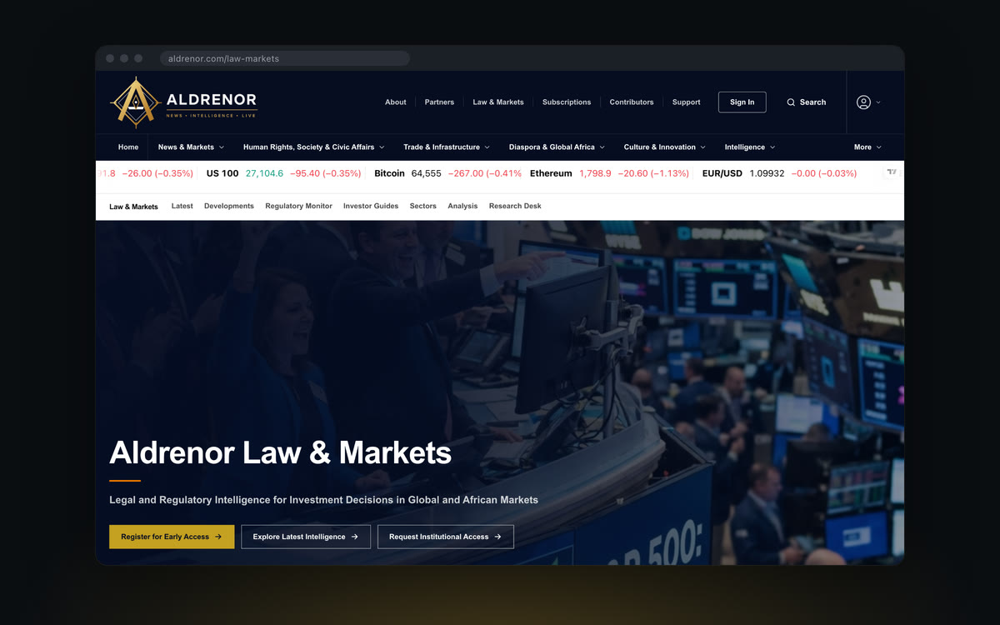
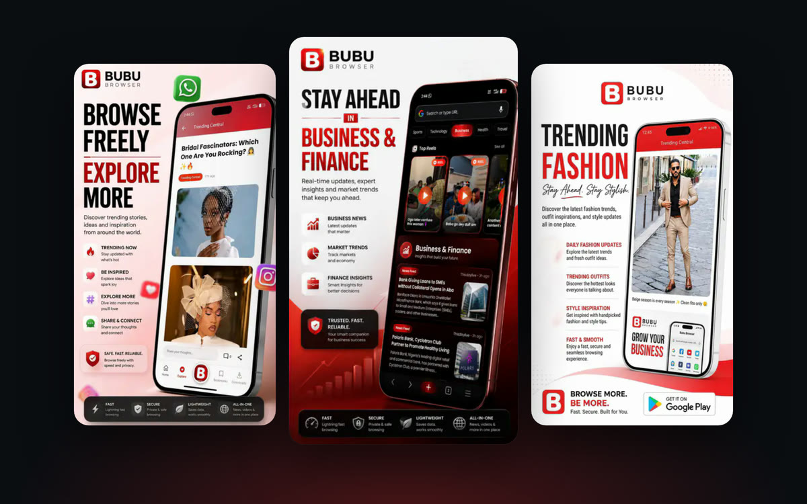

<picture>
  <source media="(prefers-color-scheme: dark)" srcset="./assets/header-dark.png"/>
  
</picture>

 

I've spent six years as a software engineer, building products in crypto trading, fintech, media, education and consumer apps. I work on the whole product: NestJS and Laravel backends, Next.js and React on the web, and Flutter on mobile.

I care about the numbers being right. At CopyMe most of my work is making sure what a trader sees in the app matches what actually happened on the exchange, with tests that pin it down. When a figure can't be known yet, I'd rather show that than show a wrong one.

I ship in small, steady pieces: 226 merged pull requests at CopyMe in the last ten weeks. I'm open to remote roles with teams anywhere in the world.

[LinkedIn](https://www.linkedin.com/in/oyeyemimayokun) &nbsp;·&nbsp; [adenijimayokun@gmail.com](mailto:adenijimayokun@gmail.com) &nbsp;·&nbsp; [Portfolio](https://mayor167.github.io/Oyeyemi_Mayokun_Portfolio/) &nbsp;·&nbsp; [X](https://x.com/mayorsky167)

 

### Products I've built and worked on

<table>
  <tr>
    <td colspan="3" valign="top">
      
      <h3><a href="https://copyme.trade">CopyMe Trade</a>: copy real traders, set your own risk</h3>
      
A copy-trading platform. Followers choose a master trader, and every trade that master places on Bybit is copied onto the follower's own Bybit account at the dollar risk they picked. Funds never leave the exchange.

      
I work across all six codebases: the NestJS backend on MongoDB, Redis and Kafka, the Flutter app, the Next.js admin dashboard, the customer web app, the website and a Telegram onboarding bot. Every P&L, fee, funding payment and R-multiple is read back from Bybit's own execution records, and the TraderScore leaderboard and monthly rewards are built on top of those figures.

      
226 merged pull requests across the six repositories since 7 September, and more backend commits than anyone else on the team.

      
<a href="https://copyme.trade"><b>copyme.trade</b></a>

    </td>
  </tr>
  <tr>
    <td width="33%" valign="top">
      
      
<a href="https://www.aldrenor.com"><b>Aldrenor</b></a> 
      Global news and business intelligence: business, investment, law and markets, AI and energy infrastructure.

      
Next.js, TypeScript and Supabase. I built the Law & Markets section, the Partners and Contributors pages, and the admin tools behind them. 47 merged PRs.

    </td>
    <td width="33%" valign="top">
      
      
<a href="https://impactknowledge.net"><b>ImpactKnowledge</b></a> 
      A learning platform for children, young people and adults in Nigeria, with seven role dashboards, live classes, payments and certificates.

      
Next.js 14, Prisma, PostgreSQL, Socket.IO and Redis. I opened the platform's first pull request and I'm its top contributor, with 379 commits.

    </td>
    <td width="33%" valign="top">
      
      
<a href="https://play.google.com/store/apps/details?id=com.jacombeventures.bububrowser"><b>Bubu Browser</b></a> 
      A fast, lightweight Android browser with a built-in feed of news, trending stories and reels.

      
Flutter and Firebase, with an RSS news pipeline and an admin app that publishes stories and ads to users in real time. <a href="https://play.google.com/store/apps/details?id=com.jacombeventures.bububrowser">Google Play</a>

    </td>
  </tr>
</table>

### Other things I've built

<table>
  <tr><td nowrap><b>Ifo: Folktales of Africa</b></td><td>A podcast-style app of African folktales in audio and video. I worked on the Flutter app: background playback with lock-screen controls, resume where you left off, and new-episode notifications sent by a Cloud Function.</td></tr>
  <tr><td nowrap><a href="https://mobilenig.com"><b>Mobilenig</b></a></td><td>Airtime, data and bill payments, with a Flutter app and a Bootstrap web app.</td></tr>
  <tr><td nowrap><a href="https://www.naira4coin.com/portal/"><b>Naira4coin</b></a></td><td>Buy and sell BTC, ETH and USDT for naira. Flutter with GetX on a REST backend.</td></tr>
  <tr><td nowrap><a href="https://github.com/Christer1/leaseHaven"><b>LeaseHaven</b></a></td><td>Connects tenants directly with landlords to cut agency fees. I led the team and the PHP backend.</td></tr>
  <tr><td nowrap><a href="https://www.momartechnologies.com/travelin/index.html"><b>Travelin</b></a></td><td>The full frontend for a flight booking company, in HTML, Bootstrap and Gulp.</td></tr>
</table>

### Where I've worked

<table>
  <tr><td valign="top" nowrap><b>CopyMe Crypto</b> 2026 to now</td><td>Copy-trading platform on Bybit. Working across the backend, mobile app, admin dashboard, web app, website and Telegram bot.<ul><li>Trade accounting from exchange evidence: gross and net P&L, R-multiples, fees, funding and partial closes, with reconciliation for stranded and stale closes</li><li>TraderScore, the leaderboard, the incentive pool and monthly payouts, with admin views that show how every score was reached</li><li>Security hardening: single-use refresh tokens, session revocation, single-use socket tickets, verified Firebase sign-in, wallet ownership checks and Bybit key-permission rules</li><li>Admin revenue statements, Bybit commission reconciliation, campaign attribution and funnel metrics</li><li>In the app: master posts and reactions, P&L share cards, iPad layout, network recovery, and TestFlight and Play release pipelines</li><li>226 merged PRs in ten weeks; the most commits on the backend and the second most on the mobile app</li></ul></td></tr>
  <tr><td valign="top" nowrap><b>NCDF Group</b> 2026 to now</td><td>ImpactKnowledge, a learning platform for learners, parents, schools and mentors.<ul><li>Launched the platform: role dashboards, courses, live classrooms, payments and QR-verified certificates, deployed on Hetzner for a multi-country launch</li><li>Added the ImpactSkill and ImpactAbility programmes through the database, billing, membership and course editors, with programme isolation for course access</li><li>Rebuilt the public site from Figma, with real photography and WebP images</li></ul></td></tr>
  <tr><td valign="top" nowrap><b>Aldrenor</b> 2026</td><td>Global news and business-intelligence site.<ul><li>Built Law & Markets, opened it to every country, and moved its settings from code into the admin</li><li>Built the Partners, Contributors and contact pages, with form submissions delivered to the support inbox</li><li>Fixed the ad image pipeline for full-width retina ads and set up staging deploys to staging.aldrenor.com</li></ul></td></tr>
  <tr><td valign="top" nowrap><b>Mealfed</b> 2025</td><td>Delivery for restaurants, groceries, pharmacies and local stores, <a href="https://www.mealfed.com/app/">on the web</a> and <a href="https://apps.apple.com/us/app/mealfed/id6749938590">on the App Store</a>.<ul><li>Worked on the Flutter customer app for iOS, Android and web: checkout into order details, the Opay payment flow, the home screen's store and product sections, and a wallet in the bottom navigation</li><li>Built Laravel REST APIs for authentication, data management and the core business logic</li></ul></td></tr>
  <tr><td valign="top" nowrap><b>Raolak Technologies</b> 2020 to 2024</td><td>Software developer.<ul><li>Built over 50 web applications that partners used to market and sell their products and services</li><li>Built savings and loan software for employees, with automated monthly deductions and recovery</li><li>Built the Raolak Event Portal: event registration, automatic seating plans and live registration analytics for admins</li></ul></td></tr>
  <tr><td valign="top" nowrap><b>OD7 Music</b> 2022 to 2023</td><td>Part-time. Built the music website and a voting platform for music competitions.</td></tr>
</table>

### Education

B.Sc. Computer Engineering, Obafemi Awolowo University, Ile-Ife &nbsp;·&nbsp; M.Sc. Computer Engineering at the same university, in progress &nbsp;·&nbsp; ALX Software Engineering programme, 2023 to 2024

### What I work with

<picture>
  <source media="(prefers-color-scheme: dark)" srcset="https://skillicons.dev/icons?i=ts%2Cnestjs%2Cnextjs%2Creact%2Cflutter%2Cdart%2Cphp%2Claravel%2Cmongodb%2Cpostgres%2Credis%2Ckafka%2Cfirebase%2Csupabase%2Caws&theme=dark"/>
  
</picture>

  

